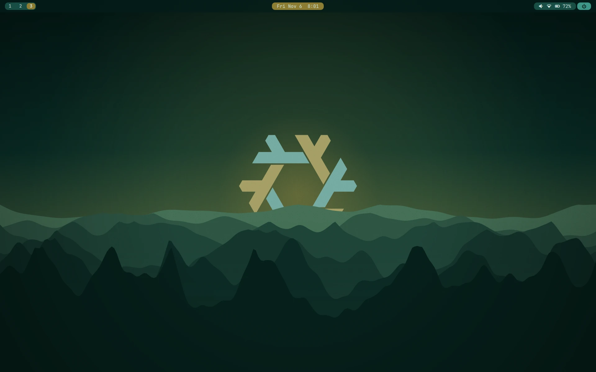
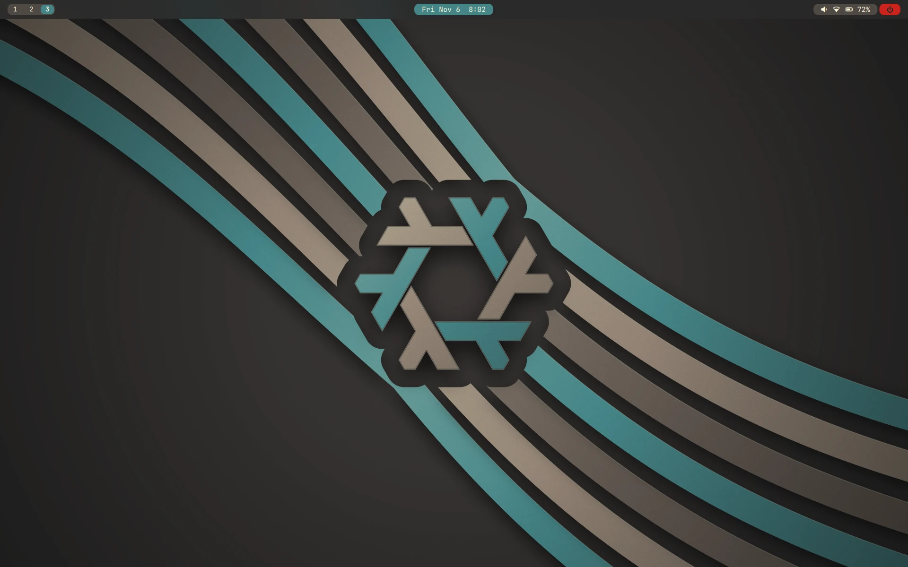
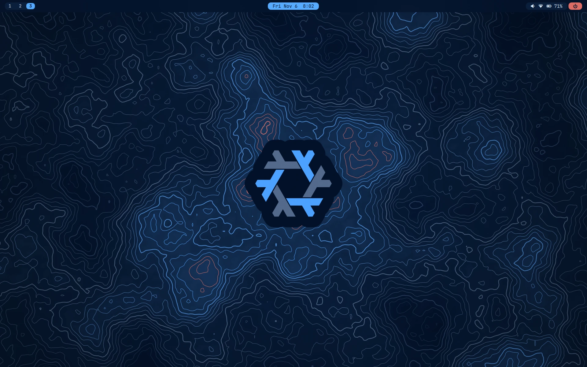
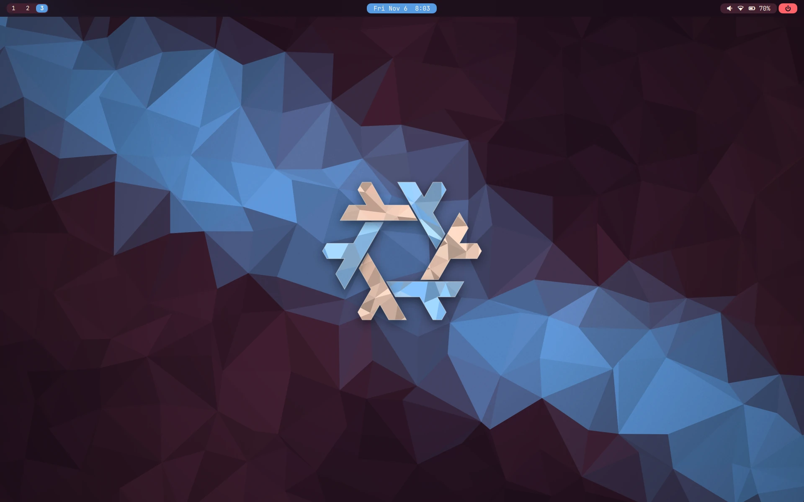
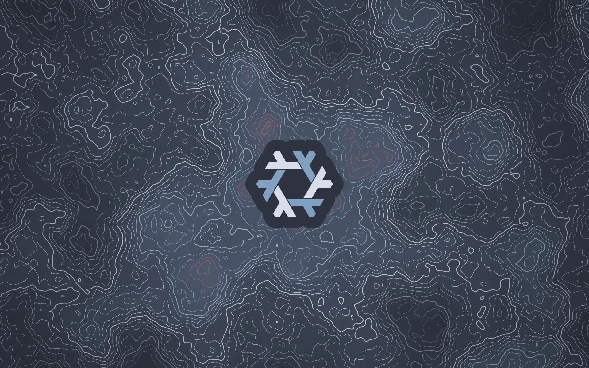
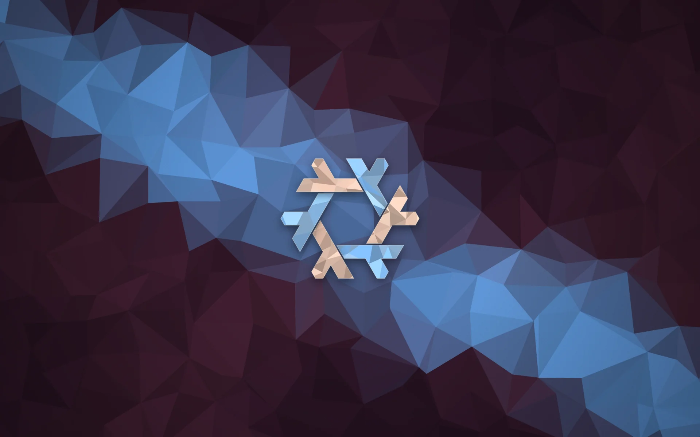
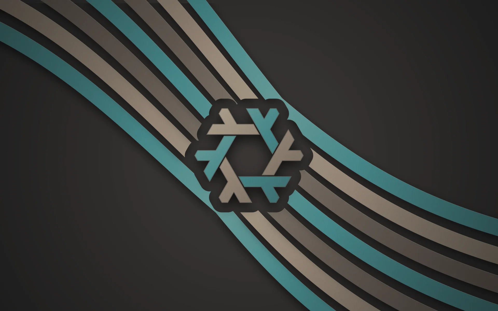
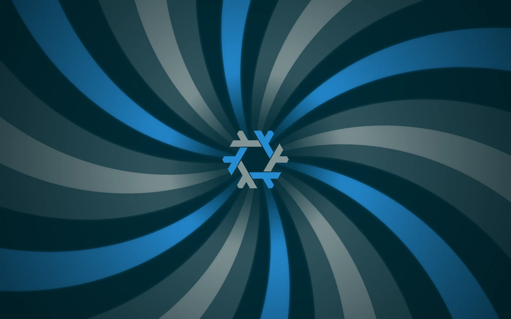

# gentleOS

A NixOS desktop on Hyprland, with its own shell, launcher and theme picker. One base16 or base24 color scheme themes everything: the apps, the login screen, the console and a wallpaper drawn in those colors. Press `SUPER + W` to try a scheme on your desktop, then keep it or revert it.

You don't fork this repo. You keep a small flake of your own that uses gentleOS as an input, so you get updates without merge conflicts. gentleOS is **unstable for now**: options can change between versions, and there's no changelog yet.

I love NixOS's declarative approach, but it takes something already hard, configuring Hyprland from scratch, and turns the difficulty up a notch. gentleOS is what I ended up with after doing that the long way, packaged so you don't have to.

<!-- screenshots:start -->
<!-- Generated with the screenshots; do not edit this section by hand. -->

<p align="center"><a href="media/README.md#apathy"></a><br><sub><b>apathy</b></sub></p>

<table>
<tr>
<td align="center" valign="top"><a href="media/README.md#gruvbox-dark"></a><br><sub><b>gruvbox-dark</b></sub></td>
<td align="center" valign="top"><a href="media/README.md#lumina-cherenkov-dark"></a><br><sub><b>lumina-cherenkov-dark</b></sub></td>
<td align="center" valign="top"><a href="media/README.md#pastelon-de-amarillos-dark"></a><br><sub><b>pastelon-de-amarillos-dark</b></sub></td>
</tr>
</table>

<p align="center"><b>Wallpapers</b>, drawn in the color scheme by <code>generate.py</code></p>

<table>
<tr>
<td align="center" valign="top"><a href="media/README.md#layered-ridges"></a><br><sub>layered-ridges</sub></td>
<td align="center" valign="top"><a href="media/README.md#contours"></a><br><sub>contours</sub></td>
<td align="center" valign="top"><a href="media/README.md#windlines"></a><br><sub>windlines</sub></td>
<td align="center" valign="top"><a href="media/README.md#flow-engraving"></a><br><sub>flow-engraving</sub></td>
</tr>
<tr>
<td align="center" valign="top"><a href="media/README.md#prism-shards"></a><br><sub>prism-shards</sub></td>
<td align="center" valign="top"><a href="media/README.md#woven-ribbons"></a><br><sub>woven-ribbons</sub></td>
<td align="center" valign="top"><a href="media/README.md#sunburst"></a><br><sub>sunburst</sub></td>
<td align="center" valign="middle" width="190"><a href="media/README.md"><b>Full gallery →</b></a><br><sub>every wallpaper in more schemes, and more desktop scenes</sub></td>
</tr>
</table>

<p align="center"><b><a href="media/README.md">Full gallery</a></b>: more scenes from the themes above, and each wallpaper in a few example color schemes</p>

<!-- screenshots:end -->

## What you get

* **Hyprland**, pinned to a release, with a [Quickshell](https://quickshell.outfoxxed.me) bar, quick settings (`SUPER + I`), notification center (`SUPER + N`), volume and brightness popups, and polkit and password prompts.
* **A launcher** on `SUPER + Space` that searches apps, open windows, keybinds and the clipboard at once. Typing a prefix first switches mode: `:` clipboard (also `SUPER + V`), `?` keybinds (also `SUPER + /`, and Enter runs the bind), `=` calculator, `@` windows, `.` emoji and Nerd Font glyphs, `>` run a command, `!` power.
* **A theme picker** on `SUPER + W`: filter 600 schemes, see one on your desktop, then keep or revert it. [Stylix](https://github.com/danth/stylix) themes the apps, and the wallpaper is drawn in the scheme's colors.
* **In the terminal:** kitty, fish, starship, neovim, tmux, yazi, fzf, lazygit, gh and nix-index.
* **Apps:** Thunar, Ark, GNOME Calculator, GNOME Boxes and Blueman, plus tools for screenshots and a color picker.
* **Underneath:** ReGreet and a boot splash, a lock screen and idle timers, PipeWire, NetworkManager, printing and firmware updates.

**Worth knowing:** there's no browser or editor in gentleOS itself. The template adds Firefox, and the rest is yours to choose. Unfree packages are allowed, and old system generations are garbage collected after 7 days, which limits how far back you can roll back. You can change both in your own config.

## Getting Started

### Requirements

* **NixOS on x86_64.** The desktop needs NixOS: Hyprland comes from the NixOS module and `gentle-theme` uses system paths, so standalone Home Manager on another distribution won't work.
* **An AMD or Intel GPU.** AMD is what this runs on daily; nothing tests Intel beyond evaluating it. NVIDIA and aarch64 aren't supported.
* **About 15 GB free.** The template assumes UEFI with systemd-boot, so a BIOS machine needs its bootloader changed in `host.nix`.

### Install

You keep your own small flake, which pulls in gentleOS as an input. These steps create it at `~/nix-config`, and it replaces `/etc/nixos/configuration.nix`, so copy over anything you need from that file.

1. **Install NixOS** with the [official guide](https://nixos.org/manual/nixos/stable/#sec-installation).

2. **Create your flake.** Stay in this terminal until you restart in step 6. First, turn on flakes until your new system is running, and open a shell with git:
   ```bash
   export NIX_CONFIG="experimental-features = nix-command flakes"
   nix-shell -p git
   ```
   Then, inside that shell, copy a small starter config into `~/nix-config`. That folder is yours, and gentleOS stays a dependency you update, not something you edit.
   ```bash
   mkdir ~/nix-config && cd ~/nix-config
   nix flake init -t github:thegentlegeek/gentleOS
   ```

3. **Fill it in:**
   - `flake.nix`: your `hostname`, your `username`, which has to be the account you're logged in as now, and `amd` or `intel`.
   - `host.nix`: your time zone, and `system.stateVersion` copied from `/etc/nixos/configuration.nix`.
   - `home.nix`: your name and email for git, and the same `stateVersion`. If this flake isn't at `~/nix-config`, also `gentleOS.flakePath`.

4. **Add your hardware configuration:**
   ```bash
   sudo nixos-generate-config --show-hardware-config > hardware-configuration.nix
   ```

5. **Add it all to git and lock it.** Flakes can't see files git doesn't know about, so `git add` any new file later too. Locking now keeps `flake.lock` yours: if `sudo` creates it in the next step, you can't update it afterwards.
   ```bash
   git init && git add .
   nix flake lock
   ```

6. **Build the system and restart.** `--accept-flake-config` uses the prebuilt Hyprland, and without it Hyprland compiles locally. This can take a while.
   ```bash
   sudo nixos-rebuild boot --accept-flake-config --flake .#YOUR_HOSTNAME
   reboot
   ```

7. **Build your desktop.** At the login screen, press `Ctrl + Alt + F2` for a text login with your usual password. If you need Wi-Fi, connect with `nmtui`. `-b backup` keeps any existing dotfiles with a `.backup` suffix. Warnings about untrusted flake configuration here are harmless, because your new system already has the Hyprland cache.
   ```bash
   cd ~/nix-config
   nix run home-manager/release-26.05 -- switch -b backup --flake .#YOUR_USERNAME
   reboot
   ```

8. **Log in and commit your config,** which the theme picker needs before it can change anything. Press `SUPER + C` for a terminal. `SUPER + /` shows every keybinding.
   ```bash
   cd ~/nix-config
   git add . && git commit -m "My gentleOS config"
   ```

### Day to day

The system side themes the login screen and console, and needs `sudo`. Home Manager runs your desktop and apps, so it's quick and doesn't.

```bash
cd ~/nix-config
home-manager switch --flake .#YOUR_USERNAME        # your desktop and apps
sudo nixos-rebuild switch --flake .#YOUR_HOSTNAME  # the system
```

To update, pull in a newer gentleOS, rebuild both, then commit, because the theme picker won't run with uncommitted changes. Your `flake.lock` pins the version you're on, so nothing changes until you do this.

```bash
nix flake update gentleOS
git commit -am "Update gentleOS"
```

### If something goes wrong

- **The new system doesn't boot or work:** pick the previous generation in the boot menu.
- **You can't log in after step 6:** check that `username` in `flake.nix` is your existing account. A new name creates an account with no password. Pick the previous generation in the boot menu, fix it, and rebuild.
- **The desktop broke after a switch:** run `home-manager generations`, then run `activate` from the previous generation's path.
- **Login returns to the greeter or shows a black screen:** press `Ctrl + Alt + F2` for a text login, then run `journalctl --user -b -u wayland-wm@hyprland.desktop`. `journalctl -t greeter` has the greeter's log. Startup output is hidden during a normal boot.
- **A bare shell instead of the desktop:** the Session list at the greeter was blank, so pick "Hyprland (quiet)". It's remembered after that. This only happens for users added after the first boot.
- **`path ... does not exist`:** `git add` the new file.
- **`Existing file ... would be clobbered`:** add `-b backup` to `home-manager switch`.

### Options

Set these in your `home.nix`. Hardware that can be detected is, so the lid, CPU temperature and sleep need no settings.

| Option | Default | What it does |
|---|---|---|
| `gentleOS.browser.personal`, `.work` | unset | Browser commands for `SUPER + B` and `SUPER + SHIFT + B`. Unset, there's no bind and web search uses `xdg-open` |
| `gentleOS.apps.editor`, `.music` | unset | Commands for `SUPER + E` and `SUPER + M`. Unset, there's no bind |
| `gentleOS.monitors.<hostname>` | none | Monitor layouts by hostname |
| `gentleOS.monitorScale` | Hyprland's choice | Scale of monitors not listed there |
| `gentleOS.keyboardLayout` | `us` | XKB layout on the desktop only. The login screen and console are set on the NixOS side |
| `gentleOS.idleSuspendSeconds` | `1800` | Idle time before sleeping. `null` never sleeps when idle |
| `gentleOS.searchUrl` | Google | The launcher's web search |
| `gentleOS.flakePath` | `~/nix-config` | Where your flake is checked out, for the theme picker |
| `gentleOS.themeFile` | gentleOS's own | Your `theme.json`. Set it on both the NixOS and Home Manager sides, as the template does |
| `gentleOS.theme.scheme`, `.wallpaper` | `theme.json` | See below |

Settings in the NixOS modules are defaults, so setting your own in your host just works. The time zone has no default, so set it there.

### Customizing Your Theme

Press `SUPER + W` for the theme picker: filter the schemes, preview one on your desktop, then keep or revert it. See [Theming](modules/shared/README.md#changing-the-theme).

To do it by hand, edit your `theme.json` and rebuild both, as in [Day to day](#day-to-day):

```json
{
  "scheme": "base16/<scheme>",
  "wallpaper": "<name>"
}
```

`scheme` is `<system>/<name>` without `.yaml`. Use `"base24/<name>"` for schemes that only exist as base24, such as `one-dark` or `cobalt2`. You can browse them in the [Tinted Theming gallery](https://tinted-theming.github.io/tinted-gallery/). New schemes arrive when you update gentleOS.

`wallpaper` is one of `layered-ridges`, `contours`, `windlines`, `flow-engraving`, `prism-shards`, `woven-ribbons` or `sunburst`, all drawn from scratch in the scheme's colors. To preview one without switching, run `nix build .#wallpapers.<name>.base16.<scheme>`.

### Growing your config

The template is one machine in a few flat files. That's only a starting point, so change the layout once it stops fitting. Remember to `git add` new files before you rebuild.

**A second machine.** Give each machine its own folder under `hosts/`:

```text
nix-config/
├── flake.nix
├── home.nix                            # Shared by both machines
├── theme.json                          # Shared by both machines
└── hosts/
    ├── laptop/
    │   ├── default.nix                 # Was host.nix
    │   └── hardware-configuration.nix
    └── desktop/
        ├── default.nix
        └── hardware-configuration.nix
```

In each `default.nix`, the theme is now two folders up: `gentleOS.themeFile = ../../theme.json;`. Then replace `outputs` in `flake.nix`, so that each machine is one line:

```nix
  outputs = { gentleOS, ... } @ inputs:
    let
      username = "me";
      specialArgs = { inherit inputs username; };
      mkHost = hostname: gpu: gentleOS.lib.mkSystem {
        specialArgs = specialArgs // { inherit hostname; };
        modules = [
          gentleOS.nixosModules.desktop
          gpu
          ./hosts/${hostname}
          ./hosts/${hostname}/hardware-configuration.nix
        ];
      };
    in
    {
      nixosConfigurations = {
        laptop = mkHost "laptop" gentleOS.nixosModules.amd;
        desktop = mkHost "desktop" gentleOS.nixosModules.intel;
      };

      homeConfigurations.${username} = gentleOS.lib.mkHomeConfig {
        inherit specialArgs;
        modules = [
          gentleOS.homeModules.desktop
          ./home.nix
        ];
      };

      legacyPackages = gentleOS.legacyPackages;
    };
```

- **Names:** each name under `nixosConfigurations` has to be that machine's hostname, because the theme picker builds the one matching the machine it's on.
- **Setting up the new machine:** follow [Install](#install), but `git clone` your config to the same path in place of `nix flake init`. Write its hardware configuration to its folder under `hosts/`, set `system.stateVersion` from that machine's `/etc/nixos/configuration.nix`, and `git add` both. Then build with `.#desktop`.
- **What's shared:** monitors go in `gentleOS.monitors.<hostname>` in `home.nix`. A theme you keep on one machine reaches the other when you `git pull` and rebuild.

**Your own modules.** When a file gets long, move part of it into its own file and import it. Home Manager and NixOS have different options, so keep their modules apart:

```nix
# home.nix: every machine gets this
imports = [ ./modules/home/media.nix ];

# hosts/desktop/default.nix: only this machine gets this
imports = [ ../../modules/nixos/gaming.nix ];
```

**Another flake input.** `pkgs` already comes from the nixpkgs gentleOS pins, so you don't need a nixpkgs input of your own, and `nix flake update gentleOS` moves it for you. For a project that isn't in nixpkgs, add it and point its nixpkgs at gentleOS's:

```nix
  inputs = {
    gentleOS.url = "github:thegentlegeek/gentleOS";
    some-tool = {
      url = "github:someone/some-tool";
      inputs.nixpkgs.follows = "gentleOS/nixpkgs";
    };
  };
```

The `outputs` above already pass `inputs` to your modules, so a module can use it:

```nix
{ pkgs, inputs, ... }:

{
  home.packages = [
    inputs.some-tool.packages.${pkgs.stdenv.hostPlatform.system}.default
  ];
}
```

`nix flake update some-tool` updates just that input. Leave out `follows` if the project has a binary cache built against its own nixpkgs, because following would make you compile it locally.

## Contributing

Suggestions and contributions are welcome! Please open an issue or pull request. Don't update the screenshots in a pull request: the maintainer regenerates them.

`nix develop` has the tools. In a checkout of this repo:

| Command | What it does |
|---|---|
| `nix flake check` | Runs everything below, plus a VM test of a new user's first login |
| `nix build .#checks.x86_64-linux.hyprland-config` | Parses the generated `hyprland.lua` with the pinned Hyprland |
| `nix build .#checks.x86_64-linux.quickshell-config` | Loads the shell and theme picker in a headless compositor, and fails on any QML error |
| `nix fmt` | Formats Nix files with nixfmt |

**Where things are:**

```
gentleOS/
├── flake.nix                    # Exports the profiles, helpers, template and wallpapers
├── lib/default.nix              # mkSystem and mkHomeConfig, for your own flake
├── templates/default/           # What `nix flake init -t` gives you
├── hosts/demo/, users/demo/     # A minimal host and user, for the checks
├── modules/
│   ├── nixos/
│   │   ├── profiles/desktop.nix # The desktop, system side: start here
│   │   ├── base.nix             # Flakes and shell aliases
│   │   ├── boot/                # Boot splash (Plymouth)
│   │   ├── cli/                 # CLI tools (neovim, yazi, tmux, fzf, lazygit)
│   │   ├── hardware/            # CPU and GPU support (AMD; Intel is untested)
│   │   ├── workstation/         # Sound, fonts, network, ReGreet, power
│   │   └── window-managers/     # Hyprland, UWSM and the greeter session
│   ├── home/
│   │   ├── profiles/desktop.nix # The desktop, user side: start here
│   │   ├── cli/                 # Kitty, fish, starship, nix-index, gh, rbw (optional)
│   │   └── window-managers/     # hyprland.lua, the Quickshell shell, hypridle
│   └── shared/                  # Stylix and the theme options, used by both sides
│       └── README.md            # How the theming works, and how to add a wallpaper
├── pkgs/wallpapers/             # Wallpapers in the scheme's colors
├── checks/                      # What `nix flake check` runs
└── media/                       # README screenshots and wallpaper gallery
```

**Upgrading Hyprland:** `flake.nix` pins `hyprland` and `hyprland-plugins` to a release tag such as `v0.57.0`, so you get new releases without waiting for nixpkgs, but never development builds, and `nix flake update` won't move a tag. Change the tag on both, then validate before switching:

```bash
nix flake lock
nix build .#checks.x86_64-linux.hyprland-config
```

Prebuilt binaries come from `hyprland.cachix.org`, configured in `modules/nixos/window-managers/hyprland/`.

## License

gentleOS is licensed under the [GPL 3 License](https://www.gnu.org/licenses/gpl-3.0.en.html), except for the logo below.

Six of the seven generated wallpapers draw an adaptation of the "NixOS Logo" by the NixOS Project and contributors, from [NixOS/branding](https://github.com/NixOS/branding), licensed under [CC BY 4.0](https://creativecommons.org/licenses/by/4.0/). The changes: it's recolored to the active color scheme, and depending on the style it's also cropped, shaded, reshaped, or redrawn as hatching or a mesh.

gentleOS is an independent project, and isn't affiliated with or endorsed by the NixOS project or the NixOS Foundation.
